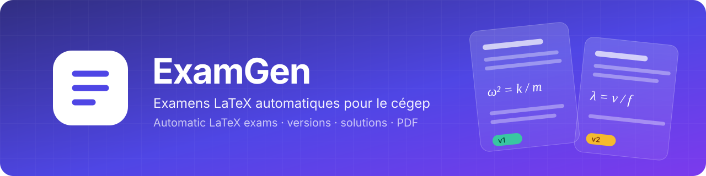
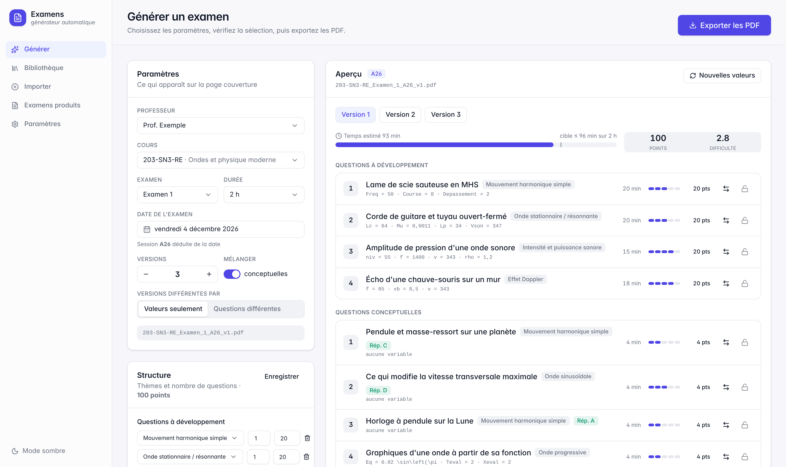
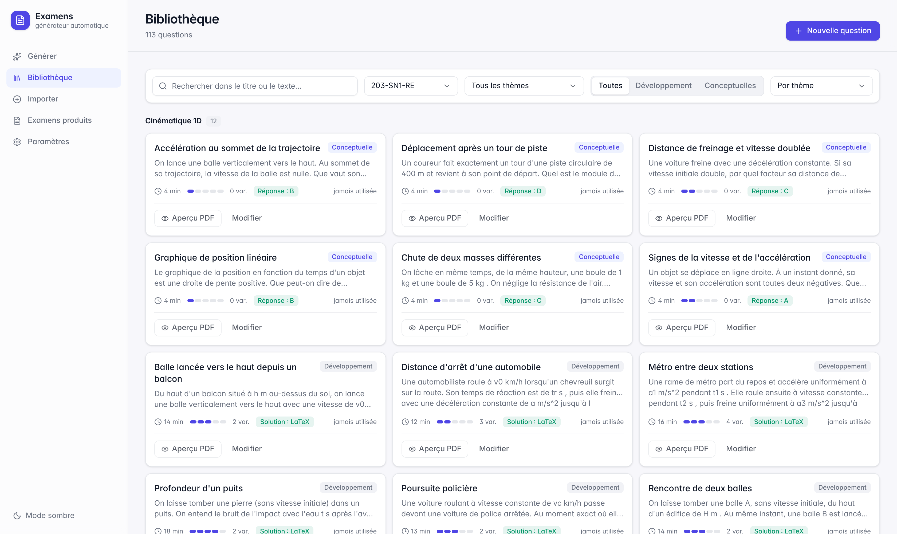
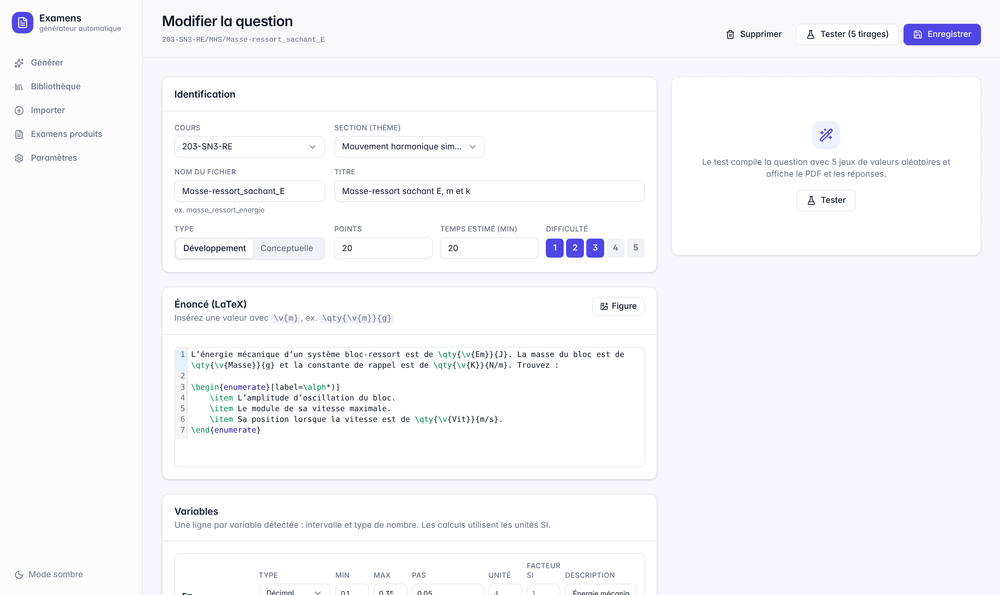
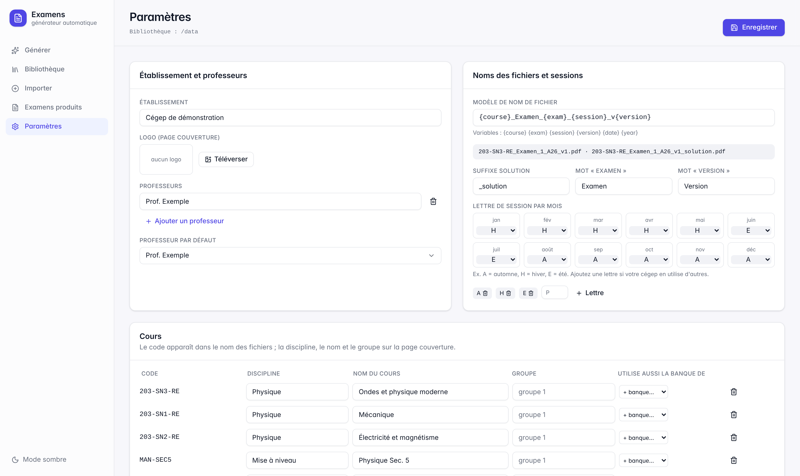

<p align="center">
  
</p>

<p align="center">
  <a href="https://github.com/JoMeloche/exam_cegep_physique/actions/workflows/ci.yml"></a>
  <a href="https://github.com/JoMeloche/exam_cegep_physique/releases/latest"></a>
  <a href="LICENSE"></a>
  
  
  
  
  
</p>

<p align="center">
  <b>Français</b> · <a href="#english">English</a>
  &nbsp;|&nbsp;
  <a href="#-installation">Installation</a> ·
  <a href="#-fonctionnalités">Fonctionnalités</a> ·
  <a href="#-ajouter-des-questions">Questions</a> ·
  <a href="CONTRIBUTING.md">Contribuer</a> ·
  <a href="CHANGELOG.md">Nouveautés</a>
</p>

**ExamGen** monte vos examens automatiquement à partir d'une banque de questions LaTeX. Vous choisissez
le professeur, le cours, le numéro d'examen, la date et la durée ; l'application choisit les questions, tire
de nouvelles valeurs numériques pour chaque version, calcule les solutions et produit un PDF d'examen et un
PDF de solutionnaire par version, par exemple `203-NYC-05_Examen_1_A26_v1.pdf` et
`203-NYC-05_Examen_1_A26_v1_solution.pdf`.

<p align="center">
  <picture>
    <source media="(prefers-color-scheme: dark)" srcset="docs/assets/generate-dark.png">
    
  </picture>
</p>

## ✨ Fonctionnalités

| | |
|---|---|
| 🎲 **Versions automatiques** | Chaque version reçoit de nouvelles valeurs tirées dans les intervalles de chaque variable, ou des questions différentes. Les choix de réponse sont mélangés. |
| 🧮 **Solutions calculées** | Solutions étape par étape calculées avec SymPy, réponses seulement, ou solutionnaire rédigé en LaTeX. |
| ✍️ **Questions en LaTeX** | Éditeur avec coloration, variables `\v{m}`, figures, et bouton **Tester** qui compile la question avec 5 jeux de valeurs avant l'enregistrement. |
| ⏱️ **Durée respectée** | Le temps estimé de chaque question guide le choix pour remplir la durée de l'examen sans la dépasser. |
| 🏫 **Pour n'importe quel cégep** | Établissement, logo, professeurs, cours, consignes de la page couverture, noms des fichiers et lettres de session se règlent dans l'application. |
| 📚 **Banque de départ** | Plus de 650 questions de physique (mécanique, électricité et magnétisme, ondes et physique moderne, mises à niveau) à modifier, compléter ou remplacer. |
| 🌗 **Interface moderne** | Interface web en français, mode clair et sombre. |
| 👥 **Comptes et partage** | Version web multi-utilisateur : demandes de compte approuvées par un administrateur, une banque par enseignant, partage de questions avec tous ou avec des collègues choisis, examens avec ou sans questions partagées. |
| 🔒 **Vos données restent chez vous** | Tout fonctionne sur votre ordinateur ou votre serveur ; aucun service en ligne. |

<table>
  <tr>
    <td width="50%"><p align="center"><sub>Bibliothèque de questions</sub></p></td>
    <td width="50%"><p align="center"><sub>Éditeur de question LaTeX</sub></p></td>
  </tr>
</table>

## 🚀 Installation

### Application de bureau

Téléchargez l'installateur de votre système dans la [**dernière version**](https://github.com/JoMeloche/exam_cegep_physique/releases/latest).
LaTeX et la banque de départ sont inclus : rien d'autre à installer.

| Système | Fichier |
|---|---|
|  | `ExamGen-Setup.exe` (installation sans droits d'administrateur) |
|  | `.dmg` pour Apple Silicon (M1 et plus) ou Intel |
|  | `ExamGen-x86_64.AppImage` (toutes distributions) ou `.deb` (Debian, Ubuntu) |

### Application web avec Docker

Pour un usage dans le navigateur, sur votre poste ou sur un serveur partagé par le département.

1. Installez [Docker Desktop](https://www.docker.com/products/docker-desktop/) (Windows, macOS) ou Docker (Linux).
2. Téléchargez ce projet (**Code → Download ZIP**, puis décompressez) ou :
   ```bash
   git clone https://github.com/JoMeloche/exam_cegep_physique.git
   cd exam_cegep_physique
   ```
3. Lancez :
   ```bash
   docker compose up -d
   ```
   Le premier lancement prend 5 à 10 minutes (installation de LaTeX). Ouvrez ensuite
   **http://localhost:8765**.
4. Créez le compte administrateur avec le code affiché par `docker compose logs examgen`
   (ou mettez `EXAMGEN_ADMIN_EMAIL` et `EXAMGEN_ADMIN_PASSWORD` dans `.env`). Un écran de bienvenue vous demande
   ensuite votre établissement, vos professeurs et vos cours.

**Comptes** : n'importe qui peut demander un compte en expliquant pourquoi ; un administrateur approuve ou
refuse la demande dans **Utilisateurs**. Chaque enseignant a sa propre banque et peut partager des questions
avec tous ou avec des collègues choisis. Pour mettre l'application en ligne en HTTPS, voir
[docs/securite.md](docs/securite.md).

Vos questions, vos examens et vos PDF sont conservés dans le dossier **`mes_examens`** à côté de
`docker-compose.yml`. Sauvegardez ce dossier ; vous pouvez le partager avec vos collègues.

| Action | Commande |
|---|---|
| Arrêter | `docker compose down` |
| Redémarrer | `docker compose up -d` |
| Mettre à jour | `git pull` puis `docker compose up -d --build` |
| Changer le port ou le dossier de données | copiez `.env.example` en `.env` et modifiez-le |

> [!NOTE]
> Votre bibliothèque dans `mes_examens` n'est jamais écrasée par une mise à jour : la banque de départ
> n'est copiée que si le dossier `questions` est vide.

### Depuis le code source

Voir [app/README.md](app/README.md) (Python 3.11+, Node 20+ et une installation LaTeX).

## 🏫 Adapter l'application à votre cégep

Tout se fait dans **Paramètres** :

- **Établissement, logo, professeurs** : imprimés sur la page couverture.
- **Cours** : code (ex. `203-NYA-05`), discipline, nom, groupe. Un cours peut **utiliser la banque d'un autre
  dossier** : votre `203-NYC-05` peut piger dans les questions du dossier `203-SN3-RE` sans rien renommer.
- **Noms des fichiers** : modèle avec `{course} {exam} {session} {version} {date} {year}`.
- **Sessions** : lettre par mois (A = automne, H = hiver, E = été par défaut).
- **Page couverture** : consignes et note en LaTeX.

La structure de chaque examen (thèmes, nombre de questions, points) se règle dans l'écran **Générer**
et s'enregistre pour la prochaine fois.

<p align="center"></p>

## 📝 Ajouter des questions

Écran **Importer** : l'énoncé en LaTeX, où chaque `\v{nom}` devient une variable ; une ligne par variable
(intervalle, type de nombre, unité) ; le temps estimé ; la difficulté ; puis la solution (automatique, réponses
seulement ou LaTeX). Le bouton **Tester** compile la question avec 5 jeux de valeurs avant l'enregistrement.

```latex
L'énergie mécanique d'un système bloc-ressort est de \qty{\v{Em}}{J}.
La masse du bloc est de \qty{\v{Masse}}{g} et la constante de rappel est de \qty{\v{K}}{N/m}.
```

Le format des fichiers est décrit dans [docs/question_format.md](docs/question_format.md). Vous avez de bonnes
questions ? [Proposez-les](CONTRIBUTING.md#proposer-des-questions) pour la banque commune.

## 🗂️ Contenu du dépôt

| Dossier | Contenu |
|---|---|
| `app/backend/` | Moteur Python (`examgen`) : tirage des valeurs, solutions SymPy, LaTeX, API FastAPI |
| `app/frontend/` | Interface React + Tailwind |
| `app/packaging/` | Applications de bureau Windows, macOS et Linux |
| `questions/<cours>/<thème>/` | La banque : `nom.tex` (énoncé), `nom.yaml` (variables, temps, difficulté, solution), `nom.sol.tex` |
| `figures/` | Images des questions |
| `exams/<cours>/examen_<N>.yaml` | Structure des examens |
| `config.yaml` | Configuration de départ (sans établissement ni professeur) |
| `docs/` | Format des questions, captures d'écran |
| `legacy/` | L'examen SN3 d'origine, fait à la main, d'où la banque a été importée |

## 🤝 Contribuer

Les contributions sont les bienvenues : questions, corrections, traductions, code. Lisez le
[guide de contribution](CONTRIBUTING.md) et le [code de conduite](CODE_OF_CONDUCT.md).
Pour signaler un problème de sécurité, voir [SECURITY.md](SECURITY.md) ; le modèle de sécurité de la version web est décrit dans [docs/securite.md](docs/securite.md).

- 🐛 [Signaler un bogue](https://github.com/JoMeloche/exam_cegep_physique/issues/new?template=bug_report.yml)
- 💡 [Proposer une idée](https://github.com/JoMeloche/exam_cegep_physique/issues/new?template=feature_request.yml)
- 📝 [Proposer une question](https://github.com/JoMeloche/exam_cegep_physique/issues/new?template=question_submission.yml)

## 📄 Licence

[MIT](LICENSE) : libre d'utiliser, modifier et partager, en conservant l'avis de licence.

---

<a id="english"></a>

<p align="center"><a href="#readme">Français</a> · <b>English</b></p>

# ExamGen (English)

**ExamGen** builds exams automatically from a LaTeX question bank. Choose the professor, course, exam number,
date and duration; the app picks the questions, draws fresh values for every version, computes the solutions and
outputs one exam PDF and one solution PDF per version (e.g. `203-NYC-05_Examen_1_A26_v1.pdf`).
The interface is in French; it was built for Québec cégeps but works for any course that uses LaTeX.

## ✨ Features

- 🎲 **Automatic versions**: fresh values drawn from each variable's range, or different questions per version;
  multiple-choice answers shuffled.
- 🧮 **Computed solutions**: step-by-step with SymPy, answers only, or a hand-written LaTeX solution.
- ✍️ **LaTeX questions**: editor with highlighting, `\v{m}` variables, figures, and a **Test** button that compiles
  the question with 5 sets of values before saving.
- ⏱️ **Fits the time slot**: each question's estimated time drives the selection so the exam fits its duration.
- 🏫 **Any institution**: school, logo, professors, courses, cover-page text, file naming and session letters
  are all set in the app.
- 📚 **Starter bank**: 650+ physics questions (mechanics, E&M, waves & modern physics, upgrading courses).
- 👥 **Accounts and sharing** (web app): account requests approved by an administrator, one bank per teacher,
  share questions with everyone or chosen colleagues, build exams with or without shared questions.
- 🔒 **Local first**: runs on your computer or your own server; no online service.

## 🚀 Install

**Desktop app**: download the installer for your system from the
[latest release](https://github.com/JoMeloche/exam_cegep_physique/releases/latest): `ExamGen-Setup.exe` (Windows),
`.dmg` (macOS, Apple Silicon or Intel), `.AppImage` or `.deb` (Linux). LaTeX and the starter bank are included.

**Web app with Docker**:

```bash
git clone https://github.com/JoMeloche/exam_cegep_physique.git
cd exam_cegep_physique
docker compose up -d        # first start takes 5–10 minutes (installs LaTeX)
```

Open **http://localhost:8765** and create the administrator account with the code shown by
`docker compose logs examgen` (or set `EXAMGEN_ADMIN_EMAIL`/`EXAMGEN_ADMIN_PASSWORD` in `.env`); a welcome
screen then asks for your institution, professors and courses.

**Accounts**: anyone can request an account with a reason; an administrator approves or rejects it under
**Utilisateurs**. Each teacher gets their own bank and can share questions with everyone or chosen colleagues.
HTTPS deployment and the security model: [docs/securite.md](docs/securite.md) (French).
Your library and PDFs live in the **`mes_examens`** folder next to `docker-compose.yml`.
Stop: `docker compose down`. Update: `git pull` then `docker compose up -d --build`.
Port and data folder: copy `.env.example` to `.env`.

**From source**: see [app/README.md](app/README.md).

## 🏫 Adapting it

**Settings** covers institution, logo, professors, courses (a course can draw from another course's question
folder, e.g. your `203-NYC-05` using `203-SN3-RE`), file-name pattern, session letters and cover-page text.
The question format is in [docs/question_format.md](docs/question_format.md).

## 🤝 Contributing

Questions, fixes, translations and code are welcome. See [CONTRIBUTING.md](CONTRIBUTING.md),
the [Code of Conduct](CODE_OF_CONDUCT.md) and [SECURITY.md](SECURITY.md).

## 📄 License

[MIT](LICENSE).
